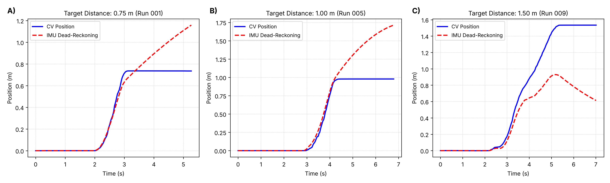
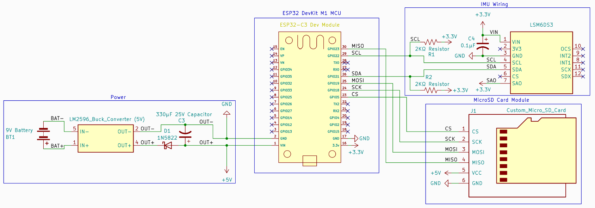
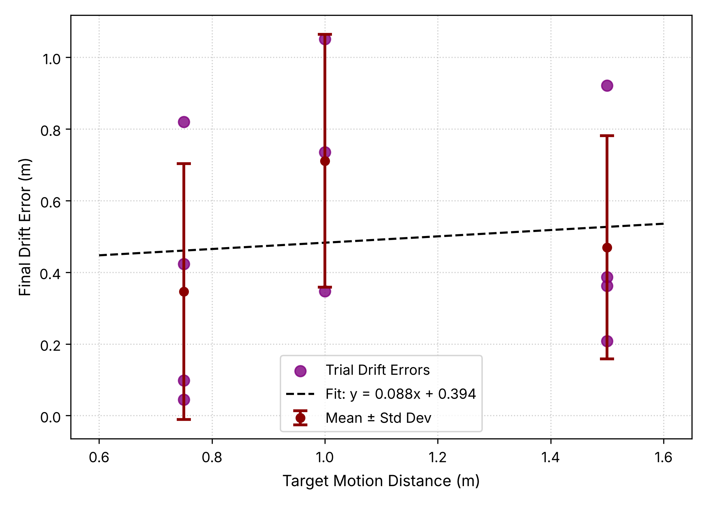
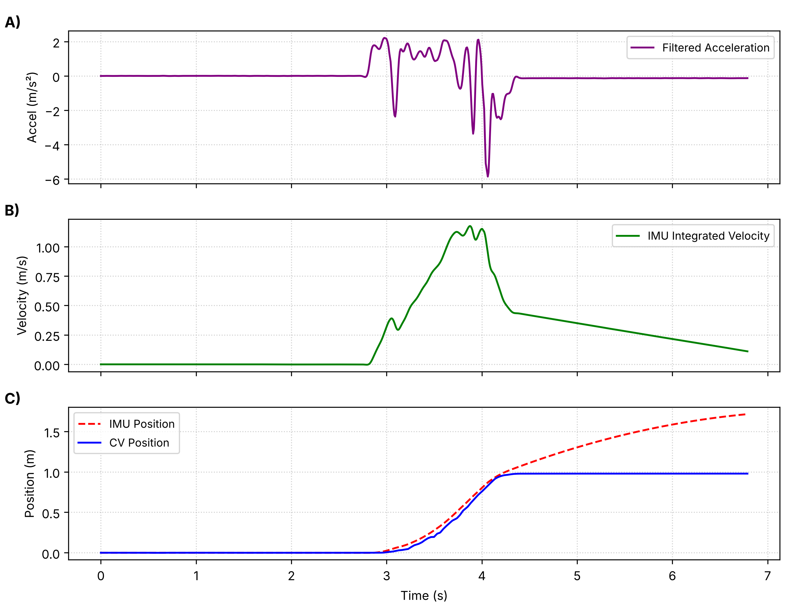

# RC Car IMU vs. CV Motion Tracker

This repository contains the hardware design, firmware, data collection scripts, raw data, and analysis code for our study:

> **Investigation of the efficacy of smartphone-camera-based computer vision for 1-dimensional position tracking versus traditional inertial measurement units**

We built a One-Dimensional (1D) testbed where a Remote-Controlled (RC) car carried an ESP32-based Inertial Measurement Unit (IMU) logger and an ArUco marker along a straight guide rail. The IMU logged acceleration onboard at about 122 Hertz (Hz), while a smartphone camera recorded 1080p video at 30 Frames Per Second (FPS) and OpenCV estimated the marker's position frame by frame. We then lined up both sensors on a shared clock and compared how far off each one was.

Everything needed to rebuild the testbed, collect new trials, or reproduce the tables and figures in the paper from our raw data is in this repo.

## Key Results

Across 11 trials (12 recorded, 1 excluded for mismatched files) at target distances of 0.75 m, 1.00 m, and 1.50 m:

- **Smartphone Computer Vision (CV)** was off from the target distance by a mean of **5.13% ± 5.71%** (3.69% without Run 004, where the car overshot into the padding).
- **Standalone IMU dead-reckoning** error averaged **45.91% ± 33.97%** of CV travel, and the calculated position kept drifting after the car stopped because of leftover velocity error.
- CV error was lower than IMU error in **all 11 trials** (sign test, *p* ≈ 0.001; Wilcoxon signed-rank test, *p* ≈ 0.001).
- While the car sat at rest, the CV position varied by only 0.03 to 1.5 mm (standard deviation).



*CV position (blue) vs. IMU dead-reckoning (red) for Run 001 (0.75 m), Run 005 (1.00 m), and Run 009 (1.50 m). The CV curve flattens out when the car stops, while the IMU curve keeps going up or down.*

## Why This Matters

An IMU does not measure position directly. To get position, the acceleration has to be integrated twice, so even a tiny constant bias *b<sub>a</sub>* turns into position error that grows with time squared:

```
Δx(t) = Δv₀·t + ½·b_a·t²
```

For example, a bias of only 0.05 m/s² gives about 0.625 m of drift after 5 seconds. CV does not have this problem because it calculates position fresh from each image, so errors do not pile up over time.

Professional motion capture systems like Vicon or OptiTrack are very accurate but cost far more than most students, hobbyists, and small robotics programs can afford. We wanted to see if a regular smartphone and a printed marker could do the job instead.

## Repository Structure

```
RC-Car-IMU-vs-CV-motion-tracker/
├── Data/
│   ├── Raw Data/                  # imu_run_XXX.csv (ESP32) and cv_data_XXX.csv (laptop), runs 001–012
│   └── Processed Data/            # merged trials, Tables 1–2, summary statistics, diagnostics, figures
|   └── Figures                    # contains all generated figures based on trial data
├── Hardware/
│   ├── Circuit Schematics/        # full circuit schematic (PDF, with and without drawing sheet)
│   ├── Diagrams/
│   └── Pictures/
├── Software/
│   ├── ESP32 C++ Firmware/        # IMU_vs_CV_tracker_ESP32_firmware.ino
│   ├── Data Collection Scripts/   # cv_tracker.py, cv_tracker_quicktest.py, verify.py
│   └── Data Processing Scripts/   # process_and_merge.py, generate_paper_figures.py
└── License/
```

## Hardware

| Component | Part used |
|---|---|
| Vehicle | ACAMMZAR 4WD drift car with drift tires, 508 g (1.12 lb) |
| Microcontroller | Espressif ESP32 Development Module (ESP32-WROOM-32) |
| IMU | STMicroelectronics LSM6DS3 6-axis (3-axis accelerometer + 3-axis gyroscope) |
| Storage | SPI microSD card module with a 32 GB microSD card |
| Power | 9 V alkaline battery → LM2596 buck converter (5 V), 1N5822 diode, 330 µF capacitor |
| Camera | Samsung Galaxy S26+ (main 24 mm equivalent lens), on a tripod 0.30 m above the track |
| Host computer | MacBook Air M3, connected to the phone over USB-C |
| Marker | 120 mm × 120 mm printed ArUco marker (`DICT_4X4_50`, Tag ID 0) |
| Track | 2.0 m guide rail made of cardboard cylinders, with cotton padding against a heavy box as the end-stop |

The circuit was built on a perfboard. The LM2596 steps the battery down to 5 V for the ESP32's `VIN` pin and the microSD module, and the IMU runs off the ESP32's 3.3 V regulator. A 1N5822 diode and a 330 µF capacitor sit on the 5 V rail. The IMU's I2C lines each have a 2 kΩ pull-up resistor to 3.3 V, and a 0.1 µF capacitor decouples the IMU's power pin. The IMU's `SAO` pin is tied to 3.3 V, which sets its I2C address to `0x6B` (the firmware tries both `0x6A` and `0x6B`).



*Complete circuit schematic: power stage (left), ESP32 (center), LSM6DS3 IMU (top right), and SPI microSD card module (bottom right). PDF versions are in [`Hardware/Circuit Schematics`](Hardware/Circuit%20Schematics).*

Pin assignments used by the firmware:

| Signal | ESP32 GPIO |
|---|---|
| IMU SDA | 22 |
| IMU SCL | 21 |
| SD CS | 5 |
| SD SCK | 18 |
| SD MOSI | 19 |
| SD MISO | 23 |
| Status LED | 2 |

The schematic labels GPIO 22 as SCL and GPIO 21 as SDA, which is the reverse of what the firmware sets. If the ESP32 prints `imu initialization failed` on boot, swap the two pin numbers at the top of the firmware (`IMU_SDA_PIN` and `IMU_SCL_PIN`) to match your wiring.

The marker was hot-glued to rigid cardboard and mounted near the car's Center of Gravity (CoG), facing the camera. The offset from the marker to the IMU was measured as **r**<sub>offset</sub> = [−0.004, −0.0381, 0.00] m.

## Software Setup

### ESP32 firmware

1. Install the [Arduino IDE](https://www.arduino.cc/en/software) and add the ESP32 board package from Espressif.
2. Install the **Adafruit LSM6DS** library (it provides `Adafruit_LSM6DS3.h`) through the Library Manager. `WiFi`, `WebServer`, `SPI`, `SD`, and `Wire` come with the ESP32 core.
3. Open `Software/ESP32 C++ Firmware/IMU_vs_CV_tracker_ESP32_firmware.ino`, select your ESP32 board, and upload.

On boot, the ESP32 creates its own Wi-Fi network and waits for commands:

- **Network name:** `RC_Tracker_Net`
- **Password:** `password123`
- **IP address / UDP port:** `192.168.4.1` / `4242`

You can open `http://192.168.4.1` in a browser while connected to check the active file name, logging status, and sample count. If you plan to use this anywhere outside a test bench, change the password in the firmware first.

The firmware listens for three User Datagram Protocol (UDP) messages:

| Message | What it does |
|---|---|
| `START:<host_time_us>` | Sets the ESP32 clock to the laptop's Unix time and opens the next `imu_run_XXX.csv` on the SD card |
| `STOP` | Closes the current log file |
| `CALIBRATE` | Averages 300 samples to estimate onboard sensor bias (optional, not used for the paper since bias was removed during processing) |

Each row is logged as `timestamp_unix_us, accel_x, accel_y, accel_z, gyro_x, gyro_y, gyro_z`, with axes remapped to the vehicle frame. The log runs at about 122 Hz, but the time between samples is uneven (median 8 ms, with gaps up to 67 ms).

### Python environment

We used Python 3.14.7 on macOS with the following versions:

```bash
pip install opencv-python==5.0.0.93 numpy==2.4.6 scipy==1.18.1 pandas==3.0.6 matplotlib==3.10.8
```

Newer versions will most likely work, but these are the ones the paper's results were produced with.

### Camera calibration

`cv_tracker.py` expects a `camera_calib.npz` file in the folder it is run from, containing `camera_matrix` and `dist_coeffs`. We made ours with OpenCV's standard checkerboard calibration using a 7 × 10 board with 25 mm squares (9 × 6 inner corners). Our calibrated values were:

- *f<sub>x</sub>* = 1278.35 px, *f<sub>y</sub>* = 1278.57 px
- *c<sub>x</sub>* = 963.19 px, *c<sub>y</sub>* = 547.09 px
- *D* = [0.054, −0.280, 0.003, −0.0004, 0.295]

These values are specific to our phone and resolution, so you will need to calibrate your own camera. The calibration script and file are not included in this repo.

## Collecting Data

1. Line up the guide rail and mark the start line and the target distance with tape.
2. Put the camera on a tripod perpendicular to the track so the whole path is in view.
3. Connect the phone to the laptop over USB-C and join the laptop to `RC_Tracker_Net`.
4. Run the quick test to make sure the marker is being detected:
   ```bash
   python3 cv_tracker_quicktest.py
   ```
   This uses a rough built-in camera matrix and needs no calibration file, so only use it to check detection, not for real measurements.
5. Place the car at the start line and run the tracker:
   ```bash
   python3 cv_tracker.py          # auto-selects the first working camera
   python3 cv_tracker.py 1        # or pick a camera index manually
   ```
   The script sends `START` to the ESP32 and shows `ESP32: SYNCED` in the video window once it gets an acknowledgment back. If it shows `ESP32: NO ACK`, check that the laptop is on the ESP32's network.
6. Hold the car still for **at least 1.5 seconds**. This window is used later to remove accelerometer bias.
7. Drive the car forward with low throttle and let go about 1 second before it reaches the padding.
8. Let it sit for a couple of seconds after it stops, then press **`q`**. This sends `STOP` to the ESP32 and closes the CV log.

Each trial produces `cv_data_XXX.csv` on the laptop and `imu_run_XXX.csv` on the SD card. To check that a pair of files actually overlaps in time:

```bash
python3 verify.py imu_run_001.csv cv_data_002.csv
```

Note that `cv_tracker.py` uses macOS's `AVFoundation` camera backend. On Windows or Linux, change `cv2.CAP_AVFOUNDATION` to your platform's backend (or remove it).

## Processing and Reproducing the Results

Both scripts take folder paths as arguments. Since the folder names have spaces, keep the quotes.

```bash
# Merge each IMU/CV pair, filter, integrate, align, and compute errors
python3 "Software/Data Processing Scripts/process_and_merge.py" "Data/Raw Data" "Data/Processed Data"

# Build Tables 1–2, summary statistics, and Figures 2–4
python3 "Software/Data Processing Scripts/generate_paper_figures.py" "Data/Processed Data"
```

Running these on the raw data in this repo reproduces the numbers in the paper exactly.

### What `process_and_merge.py` does

**IMU:**
1. Puts both sensors on the laptop's clock, with *t* = 0 at the first IMU sample.
2. Filters the forward acceleration (`accel_y` column) with a zero-phase 2nd-order Butterworth low-pass filter at 10 Hz (`scipy.signal.filtfilt`), so there is no phase lag.
3. Subtracts the mean acceleration from the first 1.5 s (the zero-g bias).
4. Integrates twice with the trapezoidal rule. Velocity is clamped to zero during the first 1.5 s (a Zero-Velocity Update, or ZUPT), but not after the car stops.

**CV:**
1. Keeps only Tag ID 0. Tags 17 and 37 showed up as false detections in a few files and are thrown out.
2. Re-applies the Exponential Moving Average (EMA) filter (α = 0.7), then a 15-frame centered rolling median to remove jitter.
3. Multiplies by **1.20**, because `cv_tracker.py` assumes a 100 mm marker but the printed one was 120 mm.
4. Resamples the 30 FPS CV data onto the 122 Hz IMU time grid with `np.interp`.

**Alignment:**
Any leftover delay is found with cross-correlation of the IMU and CV velocities within ±0.5 s, and the CV time base is shifted by that amount. On average, the CV trace lagged the IMU by 79 ms ± 64 ms.

### Trial pairing and exclusions

IMU and camera files are paired by their start timestamps, not by file number:

- `imu_run_001` pairs with `cv_data_002`, and `imu_run_002` pairs with `cv_data_001`, because the camera file numbers got swapped.
- **Run 006 is excluded.** Its IMU and camera files were recorded 48 minutes apart, and no matching file exists for either one.

| Target distance | Trials |
|---|---|
| 0.75 m | 001, 002, 003, 004 |
| 1.00 m | 005, 007, 008 |
| 1.50 m | 009, 010, 011, 012 |

## Data Files

| File | Description |
|---|---|
| `Raw Data/imu_run_XXX.csv` | Raw ESP32 log: synced Unix timestamp (µs), 3-axis acceleration (m/s²), 3-axis angular velocity (rad/s) |
| `Raw Data/cv_data_XXX.csv` | Raw CV log: timestamp, tag ID, raw and EMA-filtered position (m), roll/pitch/yaw (rad), filtered velocity (m/s) |
| `Processed Data/research_telemetry_merged_XXX.csv` | One merged trial with filtered acceleration, IMU velocity and position, aligned CV position, and position error |
| `Processed Data/table1_distance_summaries.csv` | Paper Table 1: results by distance block (mean ± SD) |
| `Processed Data/table2_individual_trials.csv` | Paper Table 2: results for every trial |
| `Processed Data/summary_statistics.json` | Overall means, sign test, Wilcoxon test, and regression results |
| `Processed Data/processing_diagnostics.csv` | Per-trial checks: sample rate, sync gap, bias, lag, clipping, rest-state CV noise, and more |

## Results by Distance

| Target (m) | Trials | CV Travel (m) | IMU Travel (m) | CV Dev. (%) | IMU Error (%) | MAE (m) | RMSE (m) |
|---|---|---|---|---|---|---|---|
| 0.75 | 4 | 0.789 ± 0.074 | 1.135 ± 0.418 | 6.31 | 41.89 | 0.077 | 0.135 |
| 1.00 | 3 | 0.976 ± 0.031 | 1.456 ± 0.763 | 2.77 | 72.13 | 0.178 | 0.295 |
| 1.50 | 4 | 1.570 ± 0.084 | 1.204 ± 0.514 | 5.71 | 30.28 | 0.155 | 0.237 |

CV deviation (CV Dev.) is how far the CV travel was from the taped target, as a percentage of the target. IMU error is the final IMU error as a percentage of CV travel. Mean Absolute Error (MAE) and Root Mean Square Error (RMSE) compare the IMU and CV positions over the whole trial.

We also found that the IMU's final drift did not get bigger with longer distances (*r* = 0.088, *p* ≈ 0.80). It seemed to depend more on what happened when the car hit the end-stop.



*IMU final drift error for each trial, with block means ± standard deviation and a linear fit (y = 0.088x + 0.394). The slope is not significant, so longer runs did not reliably produce more drift.*

The drift instead came from two different failure modes. In seven trials, the calculated velocity was still positive after the car stopped, so the IMU position kept curving upward. In the other four, the impact left the velocity negative, so the position drifted backward.



*Run 005: filtered acceleration (top), integrated IMU velocity (middle), and IMU vs. CV position (bottom). The velocity never returns to zero after the car stops, which is what causes the drift.*

## Limitations

- **1D motion only.** The guide rail limited steering and rotation, so these results do not cover full 2D or 3D movement.
- **Rolling shutter.** Smartphone cameras read pixel rows one at a time, which can warp the image during fast motion (about 1 m/s here).
- **Marker size at distance.** At 1.50 m, the marker was only about 117 pixels wide (compared to 188 pixels at 0.75 m), which made corner detection less precise.
- **Small sample size.** Only 11 trials were analyzed.
- **No independent ground truth.** Accuracy was judged against tape marks on the track, and the car overshot into the padding by up to about 15 cm.
- **Manual throttle and a flexible marker mount.** The paperclip mount let the marker tilt by 6–22° during each run.
- **IMU limits.** The forward accelerometer channel hit its ±4 *g* limit in Runs 008, 011, and 012, and about 9% of logged rows repeat the previous reading because the sensor's 104 Hz output rate is slower than the logging loop.

## Future Work

Based on what went wrong with the IMU, we think the most useful next steps are:

1. **Automatic ZUPT:** detect when the car is at rest (low acceleration variance and low angular velocity) and clamp velocity to zero, so drift stops after the car does.
2. **Extended Kalman Filter (EKF) sensor fusion:** use the fast 122 Hz IMU between video frames and let the 30 FPS camera correct the drift.
3. **Multiple markers:** put several ArUco tags on the chassis to help when the marker looks small or is seen at a steep angle.

## License

The code in this repository (`Software/`) is released under the [MIT License](LICENSE).

The data, figures, schematic, and documentation (`Data/`, `Hardware/`, and this README) are released under the [Creative Commons Attribution 4.0 International License](LICENSE-DATA) (CC BY 4.0). You are free to share and adapt them as long as you give appropriate credit.

## AI Use

Claude Opus 5.5 (Anthropic) was used to write and debug the data processing and figure generation code and to check data integrity. Gemini 3.6 Thinking (Google) was used to help debug the data collection scripts and to write a script that generates figures from the merged data. The full disclosure is in the paper.

## Acknowledgements

We would like to thank our family for supporting us through this project and for letting us purchase the electronic components and RC car. We are very grateful for the spaces they gave us to test, collect data, and work together.

## License

See the [`License`](License) folder.
